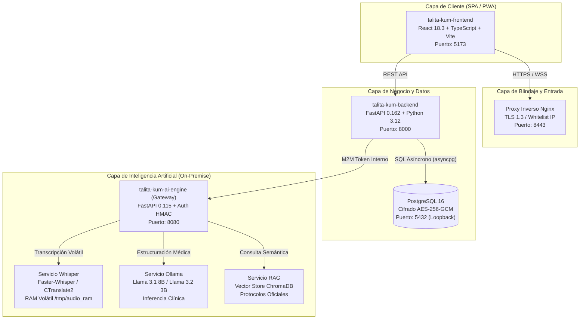

# Talita Kum — Ecosistema Clínico Asistido por Inteligencia Artificial

<p align="center">
  
  
  
  
  
  
</p>
<p align="center">
  
  
  
  
  
</p>
<p align="center">
  
  
  
</p>

---

## Metadatos del Ecosistema

- **Organización:** [Talita-Kum (GitHub)](https://github.com/Talita-Kum)
- **Proyecto:** Ecosistema Clínico Integrado para Comunidades Terapéuticas
- **Versión del Ecosistema:** 1.0.0
- **Clasificación:** Documentación Técnica Principal del Proyecto

---

## 1. Visión General del Proyecto

**Talita Kum** es una plataforma integral de salud digital y registro clínico asistido por Inteligencia Artificial local (*On-Premise*). Está diseñada para comunidades terapéuticas residenciales dedicadas a la rehabilitación de adicciones y salud mental.

El sistema asiste a los profesionales de la salud (terapeutas, psicólogos y trabajadores sociales) en la captura de sesiones clínicas mediante dictado de voz o texto, estructurando la información médica en los cuatro ejes normativos del estándar **Kimün**:
- **Objetivo:** Propósito o meta terapéutica de la atención.
- **Descripción:** Situaciones abordadas, factores de riesgo y técnicas conductuales aplicadas.
- **Resultados:** Adherencia al espacio terapéutico y respuesta del usuario.
- **Observaciones:** Acuerdos conductuales, tareas intersesión y próxima citación.

### Pilares de Ingeniería
- **Privacidad Absoluta (Zero Cloud Data Leakage):** Todo el procesamiento de audio, embeddings y modelos de lenguaje opera de forma local e interna.
- **Blindaje Biométrico (Ley N° 21.719):** El audio reside exclusivamente en memoria RAM volátil (`/tmp/audio_ram` en `tmpfs`) y es sometido a destrucción física irreversible en modo `r+b` tras la transcripción.
- **Anonimización Perimetral (Ley N° 20.584 y Ley N° 19.628):** Reemplazo reversible de RUTs, nombres y números telefónicos chilenos previo al envío de texto al modelo de lenguaje.
- **Cifrado en Reposo de Nivel Institucional:** Persistencia de relatos clínicos con cifrado de sobre simétrico AES-256-GCM y control de acceso por capacidades.

---

## 2. Arquitectura y Topología de Servicios

El ecosistema opera mediante una arquitectura de microservicios interconectados en una red privada virtualizada (`talitakum-net` / `voice-ai-net`):



---

## 3. Repositorios de la Organización

El ecosistema se distribuye en tres repositorios oficiales especializados, gestionados de forma unificada mediante un orquestador Monorepo:

### 3.1 [`talita-kum-backend`](https://github.com/Talita-Kum/talita-kum-backend)
API central de gestión asistencial, gobernanza de datos y persistencia cifrada.

| Característica | Especificación |
| :--- | :--- |
| **Tecnologías** | Python 3.12-slim, FastAPI 0.162.0, Starlette 1.10.0, Uvicorn 0.34.0 |
| **Persistencia** | PostgreSQL 16, SQLAlchemy 2.0.36 (asyncio), asyncpg 0.30.0, Alembic 1.14.0 |
| **Criptografía** | Cryptography 50.0.2 (AES-256-GCM con derivación HKDF) |
| **Seguridad** | Control de acceso basado en capacidades (`Capability`), Rate-Limiting por ventana deslizante |
| **Auditoría** | Registro inmutable de eventos asistenciales en tabla `audit_events` |

### 3.2 [`talita-kum-frontend`](https://github.com/Talita-Kum/talita-kum-frontend)
Aplicación web progresiva (PWA) de interfaz clínica con soporte offline-first.

| Característica | Especificación |
| :--- | :--- |
| **Tecnologías** | React 18.3.1, TypeScript 5.7.2, Vite 6.0.5, React Router 7.18.5 |
| **Persistencia Local** | `idb` 8.0.0 (IndexedDB tipado para resguardo offline de borradores) |
| **Audio & Voz** | Grabación en navegador (Web Audio API), soporte de dictado y carga de archivos |
| **Sesión Clínica** | Temporizador de inactividad médica (15 min con purga de memoria volátil) |
| **Testing** | Vitest 5.0.5, Testing Library 16.3.3 y Playwright 1.64.1 |

### 3.3 [`talita-kum-ai-engine`](https://github.com/Talita-Kum/talita-kum-ai-engine)
Subsistema privado de procesamiento fonético y modelos de lenguaje natural clínico.

| Característica | Especificación |
| :--- | :--- |
| **Tecnologías** | Python 3.12-slim, FastAPI 0.115.0, Uvicorn 0.34.0, Nginx 1.27 (TLS 1.3) |
| **Transcripción** | Faster-Whisper 1.0.3 sobre CTranslate2 (`large-v3-turbo` o `small`) |
| **Modelos LLM** | Ollama local (`llama3.1:8b-instruct-q4_K_M` o `llama3.2:3b` para CPU) |
| **RAG Semántico** | ChromaDB, PyPDF 5.1.0, Python-Docx 1.1.2 |
| **Hardening** | Destrucción en RAM modo `r+b`, `hmac.compare_digest`, `asyncio.to_thread` |

---

## 4. Guía de Instalación Rápida

### 4.1 Requisitos Previos

- **Docker Desktop:** Versión 4.30 o superior con Docker Compose v2.20+.
- **Memoria RAM Asignada:** Mínimo 12 GB para ejecución en CPU; 16 GB a 32 GB para GPU.
- **Almacenamiento:** 25 GB libres en disco SSD.
- **Aceleración Gráfica (Opcional):** Tarjeta NVIDIA con >= 6 GB VRAM y NVIDIA Container Toolkit.

### 4.2 Despliegue en 3 Pasos con Docker Compose

#### Paso 1: Clonar los Repositorios del Ecosistema
```bash
git clone https://github.com/Talita-Kum/talita-kum-backend.git
git clone https://github.com/Talita-Kum/talita-kum-frontend.git
git clone https://github.com/Talita-Kum/talita-kum-ai-engine.git
```

#### Paso 2: Configurar el Archivo de Entorno (`.env`)
```env
# Entorno
ENVIRONMENT=development

# Base de Datos
POSTGRES_USER=talita
POSTGRES_PASSWORD=talita_dev_pass_segura_2026
POSTGRES_DB=talita_kum
DATABASE_URL=postgresql+asyncpg://talita:talita_dev_pass_segura_2026@db:5432/talita_kum

# Secretos y Tokens Internos
DEV_AUTH_SECRET=talitakum-dev-auth-secret-key-32chars-min-ok
GATEWAY_AUTH_SECRET=talitakum-internal-gateway-token-secure-2026
AUTH_TOKEN_SECRET=talitakum-internal-gateway-token-secure-2026

# Rutas de Red
AI_GATEWAY_URL=http://ai-gateway:8080
CORS_ORIGINS=http://localhost:5173,http://127.0.0.1:5173

# Motor Whisper y Ollama (Perfil Universal CPU)
WHISPER_MODEL=small
WHISPER_DEVICE=cpu
WHISPER_COMPUTE_TYPE=int8
OLLAMA_NUM_GPU=0
```

#### Paso 3: Construcción e Inicio de Servicios
```bash
# Construir y levantar los 7 microservicios en segundo plano
docker compose up -d --build

# Verificar que todos los servicios se encuentren en estado Healthy
docker compose ps

# Descargar modelo clínico en el contenedor Ollama
docker compose exec ollama-service ollama pull llama3.2:3b
```

### 4.3 URLs de Acceso Local

| Servicio | URL Local | Descripción |
| :--- | :--- | :--- |
| **Frontend PWA** | `http://localhost:5173` | Aplicación clínica del terapeuta |
| **Backend REST API** | `http://localhost:8000/docs` | Swagger / Documentación OpenAPI |
| **AI Gateway** | `http://localhost:8080/health` | Healthcheck higienizado de la pasarela IA |
| **RAG Dashboard** | `https://localhost:8443/rag/` | Panel de ingesta documental institucional |
| **Portainer CE** | `https://localhost:9443` | Telemetría y monitoreo de contenedores |

---

## 5. Marco de Seguridad y Cumplimiento Normativo (OWASP & Leyes Chilenas)

### 5.1 OWASP Top 10 for LLM Applications (2025)

| Riesgo OWASP LLM 2025 | Mecanismo de Control Implementado en Talita Kum |
| :--- | :--- |
| **LLM01: Prompt Injection** | Confinamiento XML estricto (`<patient_clinical_narrative>`), stripping perimetral de delimitadores reservados del sistema y purga de caracteres de control Unicode (Zero-Width y BiDi). |
| **LLM02: Sensitive Information Disclosure** | Pasarela perimetral de seudonimización reversible de RUTs, nombres de pacientes y profesionales, correos y telefonía móvil y fija chilena; compuerta activa `verificar_fuga_pii`. |
| **LLM05: Improper Output Handling** | Guardrail regex post-inferencia que neutraliza comandos SQL (`SELECT`, `INSERT`, `UPDATE`, `DELETE`, `DROP`, `UNION`), código markdown y llamadas a shell en los campos de Kimün. |
| **LLM06: Excessive Agency** | Arquitectura de estructuración sintáctica pura sin herramientas autónomas, sin acceso a APIs del sistema operativo y sin privilegios de mutación directa en bases de datos. |
| **LLM07: System Prompt Leakage** | Plantilla clínica interna inmutable en formato JSON cerrado, bloqueando comandos de extracción de prompt del sistema mediante sanitización perimetral de entrada. |
| **LLM08: Vector and Embedding Weaknesses** | Aislamiento criptográfico del contexto RAG (`<trusted_rag_context origin="system_rag_knowledge_base">`) y filtrado con umbral de relevancia semántica (score >= 0.40) para descartar ruido inyectado. |
| **LLM10: Unbounded Consumption** | Acotamiento estricto de generación de tokens (`num_predict: 350`) en Ollama, esquemas Pydantic resilientes contra DoS y fallback no sintético ante indisponibilidad del motor. |

---

### 5.2 OWASP API Security Top 10 (2023)

| Riesgo OWASP API 2023 | Mecanismo de Control Implementado en Talita Kum |
| :--- | :--- |
| **API1:2023 Broken Object Level Authorization (BOLA)** | Validación de alcance organizacional y profesional en cada consulta por identificador único de intervención (`services/scope.py`). |
| **API2:2023 Broken Authentication** | Validación de credenciales de pasarela mediante `hmac.compare_digest` para evaluación en tiempo constante, mitigando ataques de canal lateral (*Timing Attacks* / CWE-208). |
| **API3:2023 Broken Object Property Level Authorization** | Esquemas de entrada Pydantic cerrados (`InterventionContextInput`, `ValidateInputFields`) con tipado estricto, impidiendo asignación masiva de campos no autorizados (*Mass Assignment*). |
| **API4:2023 Unrestricted Resource Consumption** | Límite estricto de 50 MB en audios, cuotas de memoria en contenedores Docker y control de tasa mediante `SlidingWindowLimiter`. |
| **API5:2023 Broken Function Level Authorization (BFLA)** | Control de acceso basado en capacidades (`Capability.INTERVENTION_CREATE`, `INTERVENTION_VALIDATE`, `INTERVENTION_COPY_VALIDATED`). |
| **API8:2023 Security Misconfiguration** | Cabeceras HTTP de blindaje (`X-Frame-Options: DENY`, `X-Content-Type-Options: nosniff`, `Content-Security-Policy: default-src 'none'`), supresión del header `Server` y contenedores rootless. |

---

### 5.3 OWASP Top 10 Web Application Security (2021)

| Riesgo OWASP Web 2021 | Mecanismo de Control Implementado en Talita Kum |
| :--- | :--- |
| **A01:2021 Broken Access Control** | Guardias de ruta en frontend (`ProtectedRoute`, `RequireCapability`, `SessionGate`) y temporizador de inactividad médica de 15 minutos con purga de memoria volátil. |
| **A02:2021 Cryptographic Failures** | Cifrado de sobre AES-256-GCM para relatos clínicos en reposo, canal TLS 1.3 en tránsito y destrucción física en memoria RAM (`/tmp/audio_ram` en modo `r+b` con `os.fsync`). |
| **A03:2021 Injection** | Consultas parametrizadas exclusivas mediante SQLAlchemy 2.0 asíncrono sobre PostgreSQL (cero concatenación SQL dinámico); sanitización de entrada de texto clínico. |
| **A05:2021 Security Misconfiguration** | Aislamiento de red privada interna `talitakum-net` con cero puertos de IA expuestos al host; política CORS con lista blanca explícita (`CORS_ORIGINS`). |
| **A09:2021 Security Logging and Monitoring Failures** | Pistas de auditoría inmutables en tabla `audit_events` con registro de usuario, acción, timestamp, IP y entidad afectada. |

---

### 5.4 Normativas de Salud y Privacidad (Leyes Chilenas y CIS Docker)

| Dominio | Norma / Estándar | Mecanismo de Control Aplicado |
| :--- | :--- | :--- |
| **Datos Biométricos de Voz** | Ley N° 21.719 (Chile) | Aislamiento exclusivo en `tmpfs` en RAM (`/tmp/audio_ram`). Sobrescritura física de ceros (`0x00`) y bytes criptográficos (`os.urandom`) en modo `r+b` antes del borrado. Cero persistencia en disco duro. |
| **Ficha Clínica y Privacidad** | Ley N° 20.584 y 19.628 | Pasarela de seudonimización perimetral reversible de RUTs, nombres y números telefónicos móviles y fijos chilenos previo a cualquier interacción con el modelo LLM. |
| **Contenedores Docker** | CIS Docker Benchmark v1.6.0 | Ejecución no-root (`USER 10001:10001`), sistemas de archivos en solo lectura (`read_only: true`), `cap_drop: ALL` y `no-new-privileges: true`. |
| **Concurrencia de Servidor** | Estándar de Disponibilidad API | Delegación asíncrona de inferencia y llamadas I/O de red vía `asyncio.to_thread` en endpoints FastAPI para garantizar capacidad de respuesta concurrente. |

---

## 6. Resolución Rápida de Incidencias (Troubleshooting)

| Síntoma Observado | Causa Frecuente | Solución Técnica |
| :--- | :--- | :--- |
| **Fallo de conexión a BD** | `DATABASE_URL` apunta a `127.0.0.1` en vez del host Docker | Cambiar a `db:5432` en el archivo `.env` (`postgresql+asyncpg://talita:...@db:5432/talita_kum`). |
| **Error CUDA Out of Memory** | Whisper Large en GPU con VRAM inferior a 6 GB | Conmutar a CPU con cuantización int8: `WHISPER_DEVICE=cpu` y `WHISPER_COMPUTE_TYPE=int8`. |
| **Error 401 en AI Gateway** | Desincronización de token interno entre Backend y Gateway | Homologar `GATEWAY_AUTH_SECRET` en Backend con `AUTH_TOKEN_SECRET` en AI Gateway. |
| **Error de CORS en navegador** | Origen `http://localhost:5173` ausente en el Backend | Agregar el origen exacto a `CORS_ORIGINS` en `.env`. |
| **Micrófono bloqueado** | Acceso al frontend por IP no segura en vez de localhost | Conectarse exclusivamente por `http://localhost:5173` o habilitar HTTPS con certificado TLS. |

---

## 7. Mantenimiento y Operaciones Seguras

### Respaldo de Base de Datos Local
```bash
docker compose exec -t db pg_dump -U talita -F c -b -v -f /tmp/backup_talitakum_$(date +%Y%m%d).dump talita_kum
docker cp talitakum-db:/tmp/backup_talitakum_$(date +%Y%m%d).dump ./backups/
```
> **Nota de Seguridad:** Conforme a las reglas del proyecto, los respaldos y dumps de bases de datos residen únicamente en almacenamiento físico local y quedan estrictamente excluidos del control de versiones de Git.

### Pruebas de Regresión Automatizadas
```bash
# Backend test suite
docker compose exec backend pytest

# AI Engine guardrails & mitigations test suite
docker compose exec ai-gateway python test_engine.py
```

---

<p align="center">
  <b>Talita Kum</b> — Plataforma de Salud Digital & Asistencia Clínica On-Premise
</p>
