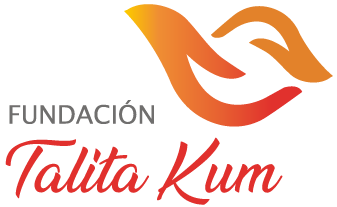

  

# Talita Kum — Ecosistema Clínico Asistido por Inteligencia Artificial

Plataforma de salud digital y registro clínico asistido por Inteligencia Artificial *On-Premise* para comunidades terapéuticas residenciales dedicadas a la rehabilitación y salud mental.

---

> [!NOTE]
> El acceso al código fuente, especificaciones técnicas de arquitectura, modelos y documentación integral del ecosistema está restringido exclusivamente a los miembros autorizados de la organización.
